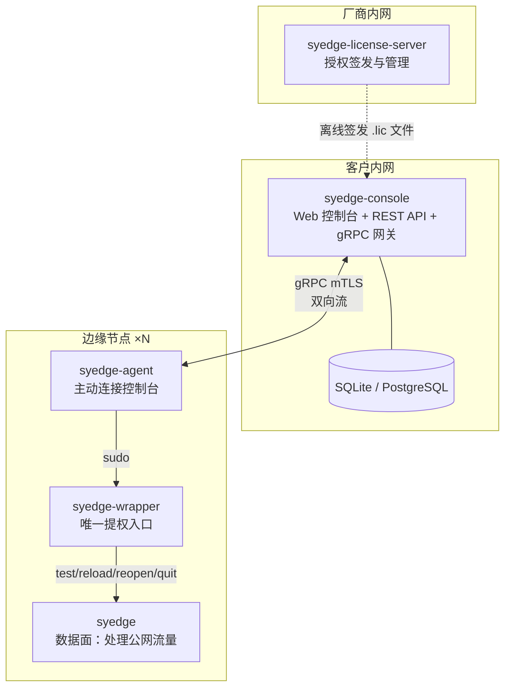
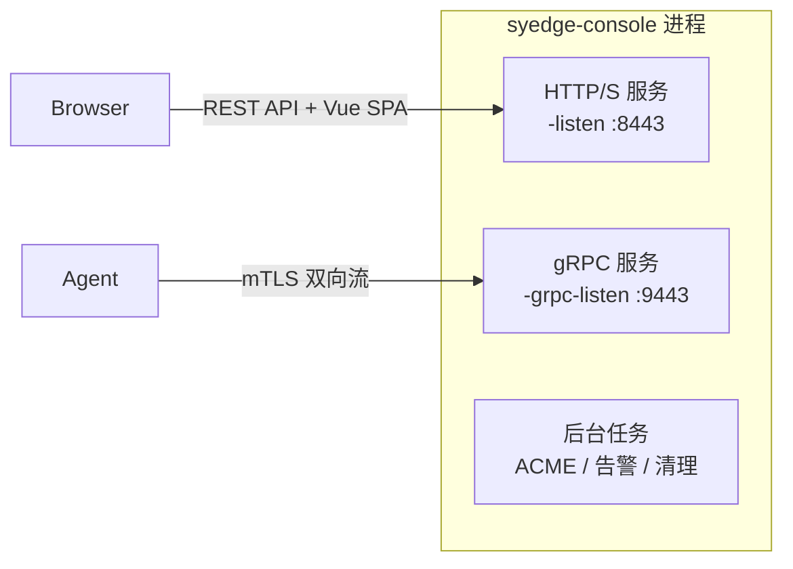
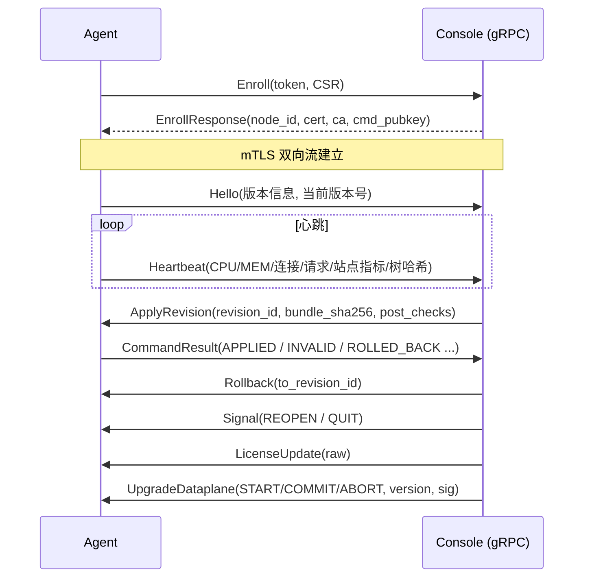
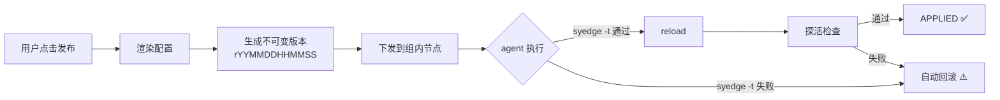

# SyEdge 代码库全景解读

> **仓库**：[edgetraffic-os](../)　|　**分支**：`main`　|　**基线版本**：`v0.1.0`（MVP）
> **语言**：Go 1.26 + Vue 3 / TypeScript　|　**后端总代码量**：~30,000 行（不含生成代码与 vendor）

---

## 1. 产品定位

SyEdge（边缘流量操作系统）是一款**基于 NGINX 开源版的边缘流量管理产品**。

核心理念：
- **数据面 `syedge`**：对 NGINX 只做改名构建（brand），不改动任何逻辑
- **控制面**：自研 Web 控制台，统一管理多台边缘节点的完整发布生命周期：**改配置 → 校验 → 下发 → reload → 验证 → 回滚**
- 内置商业授权系统



---

## 2. 五大组件总览

| 程序 | 部署位置 | 入口文件 | 核心职责 |
| --- | --- | --- | --- |
| **syedge-console** | 客户内网 | [main.go](../cmd/syedge-console/main.go) | Web 控制台、REST API、配置渲染器、发布编排、内置 CA、审计、License 校验、gRPC 网关 |
| **syedge-agent** | 每台边缘节点 | [main.go](../cmd/syedge-agent/main.go) | 主动连接控制台，本地发布状态机、指标采集、漂移检测；**不监听端口** |
| **syedge-wrapper** | 每台边缘节点 | [main.go](../cmd/syedge-wrapper/main.go) | agent 唯一的提权入口，只执行 `test / reload / reopen / quit / upgrade-*` |
| **syedge** | 每台边缘节点 | `dataplane/` | 数据面：处理公网流量（NGINX 改名构建） |
| **syedge-license-server** | 厂商内网 | [main.go](../cmd/syedge-license-server/main.go) | 客户与订单管理、License 签发 / 激活 / 吊销、授权后台 Web |

> [!IMPORTANT]
> 另有一个 **syedge-license-signer**（[main.go](../cmd/syedge-license-signer/main.go)）是**离线签名工具**，部署在离线签名机上，不含任何网络代码。正式 License 和升级包都由它签名。

---

## 3. 目录结构详解

```
edgetraffic-os/
├── cmd/                          # 6 个可执行程序入口
│   ├── syedge-console/            #   控制台（含 backup/restore 子命令）
│   ├── syedge-agent/              #   节点 agent（含 bootstrap/enroll/run/firewall 子命令）
│   ├── syedge-wrapper/            #   提权 wrapper
│   ├── syedge-license-server/     #   授权服务（含 serve/keygen/issue/inspect/request/import 等）
│   ├── syedge-license-signer/     #   离线签名工具
│   └── etos-loadgen/             #   压测生成器
│
├── api/                          # 接口定义
│   ├── proto/agent/v1/           #   控制台 ↔ agent 的 gRPC Protobuf 协议
│   ├── gen/                      #   protoc 生成的 Go 代码
│   └── openapi/                  #   OpenAPI 文档
│
├── internal/                     # 核心业务逻辑（14 个子包，~158 个 Go 文件）
│   ├── console/                  #   控制台全部后端
│   │   ├── api/                  #     REST API 路由与 Handler（Gin）
│   │   ├── deploy/               #     发布编排（渲染 → 版本 → 下发 → 回滚）
│   │   ├── gateway/              #     gRPC AgentGateway 服务端
│   │   ├── store/                #     数据模型 + GORM 存储 + gorm/gen 查询
│   │   ├── certs/                #     证书库管理
│   │   ├── acme/                 #     ACME 自动证书签发
│   │   ├── pki/                  #     内置 CA（节点证书 + Web CA）
│   │   ├── alerts/               #     告警引擎（邮件/Webhook/企微/钉钉）
│   │   ├── backup/               #     加密备份与恢复
│   │   ├── ha/                   #     高可用选主
│   │   ├── importer/             #     配置导入
│   │   ├── ipsets/               #     IP 集与地域库
│   │   ├── licsvc/               #     License 服务（评估 + 门禁）
│   │   ├── oidc/                 #     OIDC 单点登录
│   │   └── secpolicy/            #     账号安全策略（等保 2.0）
│   │
│   ├── agent/                    #   节点 agent 核心
│   │   ├── apply/                #     发布状态机 + 漂移检测
│   │   ├── collect/              #     指标采集
│   │   ├── conn/                 #     gRPC 连接管理 + 升级协调
│   │   ├── firewall/             #     nftables 防火墙规则
│   │   └── selfupdate/           #     agent 自升级
│   │
│   ├── render/                   #   配置渲染器（模型 → syedge 配置文件）
│   ├── license/                  #   License 解析、验签、状态判断
│   ├── wrapper/                  #   wrapper 命令构建与热升级
│   ├── pkgsig/                   #   升级包签名验签
│   ├── cmdsig/                   #   指令签名验签
│   ├── portal/                   #   授权后台后端
│   ├── migrate/                  #   数据库迁移
│   ├── model/                    #   （预留）共享模型
│   ├── version/                  #   版本信息注入
│   └── pkg/                      #   通用工具包
│       ├── audit/                #     审计日志
│       ├── crypto/               #     密码哈希
│       ├── secretbox/            #     对称加密（证书私钥等）
│       ├── sm2cert/              #     国密 SM2 证书
│       ├── textdiff/             #     文本差异
│       └── validate/             #     通用校验
│
├── web/                          # 前端
│   ├── src/                      #   控制台前端（Vue 3 + Vite + Ant Design Vue）
│   │   ├── views/                #     33 个页面视图
│   │   ├── components/           #     10+ 复用组件
│   │   ├── api/client.ts         #     API 客户端
│   │   └── stores/session.ts     #     Pinia 会话状态
│   ├── src-portal/               #   授权后台前端（独立 Vue 应用）
│   └── e2e/                      #   前端权限矩阵测试
│
├── dataplane/                    # 数据面构建
│   ├── build-syedge.sh            #   标准版构建（OpenSSL / 铜锁）
│   ├── build-syedge-lua.sh        #   Lua 变体构建
│   ├── patches/                  #   改名 patch（只改字符串）
│   ├── packaging/                #   RPM/DEB 打包模板
│   └── lua/                      #   LuaJIT + 动态模块
│
├── deploy/                       # 部署配置
│   ├── docker-compose.yml        #   Docker Compose
│   ├── Dockerfile.console        #   控制台镜像
│   ├── systemd/                  #   systemd 服务单元
│   └── nfpm/                     #   nfpm 打包配置
│
├── demo/                         # 一键演示环境
│   ├── demo.sh                   #   演示脚本
│   ├── docker-compose.yml        #   演示编排
│   └── e2e.sh                    #   端到端验收脚本
│
├── test/                         # 测试
│   ├── e2e/                      #   端到端测试
│   └── playwright/               #   前端 Playwright 测试
│
├── scripts/                      # 运维脚本
│   ├── brand-check.sh            #   品牌门禁（禁止出现 "nginx"）
│   ├── rename-scan.sh            #   改名扫描
│   └── golden-rename.sh          #   改名黄金验收
│
├── docs/                         # 文档
│   ├── spec/README.md            #   设计规格书索引
│   ├── acceptance.md             #   验收标准
│   ├── ha.md                     #   高可用设计
│   ├── gm.md                     #   国密设计
│   ├── lua.md                    #   Lua 扩展设计
│   ├── license-ops.md            #   授权运营流程
│   └── NOTICE                    #   开源归因
│
├── license-portal/               # 授权后台前端（独立目录）
├── vendor/                       # Go 依赖（全量 vendor）
├── Makefile                      # 构建入口
├── CLAUDE.md                     # 编码规则（强制遵守）
└── go.mod                        # Go 模块定义
```

---

## 4. 技术栈

### 4.1 后端（Go）

| 层面 | 技术 | 说明 |
| --- | --- | --- |
| HTTP 框架 | **Gin** v1.12 | REST API |
| ORM | **GORM** v1.31 + **gorm/gen** v0.3 | 类型安全查询 |
| 数据库迁移 | **gormigrate** v2.1 | 版本化迁移 |
| 数据库 | **SQLite**（单机）/ **PostgreSQL**（高可用） | 双引擎支持 |
| gRPC | **grpc-go** v1.85 + **Protobuf** v1.36 | 控制台 ↔ agent 通信 |
| 认证 | **JWT** (HS256) + HttpOnly Cookie + Bearer Token | 双模式认证 |
| 加密 | **Ed25519**（License/指令/升级包签名）、**secretbox**（证书私钥加密）| 密码学基础 |
| LDAP | **go-ldap** v3 | 企业目录集成 |
| TOTP | **pquerna/otp** v1.5 | 二次认证预留 |
| WebSocket | **gorilla/websocket** v1.5 | 实时通信 |

> [!NOTE]
> 项目**不引入** Redis / MinIO / etcd / Vault / SkyWalking（设计约束）。新增依赖必须是 MIT / BSD / Apache-2.0 许可。

### 4.2 前端

| 技术 | 版本 | 说明 |
| --- | --- | --- |
| Vue | 3.x | SPA |
| TypeScript | — | 类型安全 |
| Vite | — | 构建工具 |
| Ant Design Vue (antdv-next) | — | UI 组件库 |
| Pinia | — | 状态管理 |

前端有**两个独立应用**：
1. **控制台前端**（[web/src/](../web/src)）— 33 个页面
2. **授权后台前端**（[web/src-portal/](../web/src-portal)）— 8 个页面

---

## 5. 核心架构详解

### 5.1 控制台 syedge-console

控制台是整个系统的中枢，一个进程同时提供：



**启动流程**（[main.go](../cmd/syedge-console/main.go#L85-L238)）：

1. 打开/创建数据库（SQLite 或 PostgreSQL）
2. 加载/创建内置 CA（`pki.LoadOrCreate`）
3. 生成/读取指令签名密钥（Ed25519）
4. 初始化 License 服务
5. 初始化各业务服务（证书、部署、ACME、告警、选主）
6. 启动 gRPC 网关（mTLS）
7. 启动 HTTP 服务（Web 控制台 + REST API）
8. 启动后台任务（选主、定时清理、ACME 续期、告警）

### 5.2 控制台 REST API

API 路由定义在 [server.go](../internal/console/api/server.go#L65-L256)，核心路由分组：

| 路由前缀 | 功能模块 | 对应文件 |
| --- | --- | --- |
| `/api/v1/auth/*` | 登录/登出/OIDC/密码 | [handlers.go](../internal/console/api/handlers.go) |
| `/api/v1/node-groups/*` | 节点组管理、发布、回滚 | [handlers.go](../internal/console/api/handlers.go) |
| `/api/v1/nodes/*` | 节点管理、漂移 | [handlers.go](../internal/console/api/handlers.go) |
| `/api/v1/sites/*` | 站点 CRUD | [handlers.go](../internal/console/api/handlers.go) |
| `/api/v1/upstreams/*` | 上游 CRUD | [handlers.go](../internal/console/api/handlers.go) |
| `/api/v1/certificates/*` | 证书管理（含 ACME/国密） | [handlers.go](../internal/console/api/handlers.go) |
| `/api/v1/streams/*` | 四层代理（TCP/UDP/SNI） | [streams.go](../internal/console/api/streams.go) |
| `/api/v1/snippets/*` | 自定义配置片段 | [snippets.go](../internal/console/api/snippets.go) |
| `/api/v1/imports/*` | 配置导入 | [imports.go](../internal/console/api/imports.go) |
| `/api/v1/packages/*` | 数据面版本库 | [packages.go](../internal/console/api/packages.go) |
| `/api/v1/alerts/*` | 告警通道与规则 | [alerts.go](../internal/console/api/alerts.go) |
| `/api/v1/ip-sets/*` | IP 集/地域库 | [ipsets.go](../internal/console/api/ipsets.go) |
| `/api/v1/license/*` | 授权管理 | [handlers.go](../internal/console/api/handlers.go) |
| `/api/v1/audit/*` | 审计日志 | [handlers.go](../internal/console/api/handlers.go) |

**RBAC 四级角色**：`admin` > `operator` > `releaser` > `viewer`

**安全中间件链**：`securityHeaders` → `standbyGuard` → `csrf` → `auth` → `role(min)` → `writable` → `feature(f)` → Handler

### 5.3 Agent（syedge-agent）

Agent 运行在每台边缘节点上，**只主动连接控制台，不监听任何端口**。

**子命令**：

| 子命令 | 功能 |
| --- | --- |
| `bootstrap` | 安装时运行：写入空站点的初始版本 `r000000` |
| `enroll -server H:P -token T -ca-fingerprint F` | 用一次性令牌注册到控制台 |
| `run` | 常驻运行：建立 gRPC mTLS 双向流 |
| `firewall` | 生成 nftables 防火墙规则 |
| `version` | 打印版本 |

**核心包**：

| 包 | 职责 |
| --- | --- |
| [agent/conn](../internal/agent/conn) | gRPC 连接管理、注册、指令接收 |
| [agent/apply](../internal/agent/apply) | 发布状态机（解压 → test → reload → 探活 → 回滚）、漂移检测 |
| [agent/collect](../internal/agent/collect) | 指标采集（CPU/内存/连接/请求/分钟级站点指标） |
| [agent/selfupdate](../internal/agent/selfupdate) | agent 自升级（验签后 exec 替换） |

### 5.4 gRPC 协议

协议定义：[agent.proto](../api/proto/agent/v1/agent.proto)



> [!WARNING]
> 每条 `ServerMessage` 附带 **Ed25519 签名 + cmd_id + issued_at**，agent 验签 + 30 秒窗口防重放。协议中**禁止**任何"执行命令"或"读写任意文件"类指令。

### 5.5 配置渲染器（Render）

[internal/render/](../internal/render) 是系统的核心引擎，负责将结构化模型转为 syedge 配置文件。

```
Input (站点 + 上游 + 证书 + 规则 + 片段 + 四层代理)
  ↓  Validate()
  ↓  Go text/template 渲染
  ↓  确定性打包
Bundle { Revision, Files map, Manifest{Digest} }
```

关键文件：

| 文件 | 职责 |
| --- | --- |
| [render.go](../internal/render/render.go) | 主渲染逻辑：校验 → 模板执行 → tar.gz 打包 |
| [model.go](../internal/render/model.go) | 输入模型定义（Site, Route, Upstream 等） |
| [rules.go](../internal/render/rules.go) | 访问规则积木（IP/UA/Header/Path/Method → 拒绝/跳转/限速） |
| [snippet.go](../internal/render/snippet.go) | 自定义片段校验与规范化 |
| [lua.go](../internal/render/lua.go) | Lua 扩展渲染（JWT 沙箱等） |
| [stream.go](../internal/render/stream.go) | 四层代理渲染 |
| [validate.go](../internal/render/validate.go) | 输入校验 |
| `templates/*.tmpl` | Go 模板文件 |

> [!CAUTION]
> **禁止用字符串拼接生成配置！** 一律经 `internal/render` 的校验器 + 模板 + 转义函数。每次修改模板都要通过真实 `syedge -t` 测试。

### 5.6 发布编排（Deploy）

[deploy.go](../internal/console/deploy/deploy.go) 实现完整的发布流程：



支持的发布模式：
- **普通发布**：全量下发
- **灰度发布**（Canary）：按批次发布，监控 5xx 率，超阈值自动回滚
- **批量发布**：跨多个节点组
- **发布审批**：提交 → 另一人批准 → 下发

---

## 6. 数据模型（30 张表）

数据模型定义在 [store/model.go](../internal/console/store/model.go)，共 **30 个 GORM Model**：

### 6.1 核心业务实体

| 模型 | 说明 |
| --- | --- |
| `User` | 用户（支持 local/ldap/oidc 来源，含等保 2.0 安全字段） |
| `NodeGroup` | 节点组（配置隔离的管理单元） |
| `Node` | 边缘节点（含状态、版本、指标、漂移标记） |
| `Site` | 站点（存储 `render.Site` 的 JSON 规格） |
| `Upstream` | 上游服务组 |
| `Revision` | 不可变配置版本（含打包的 Bundle） |
| `Certificate` | 证书库（私钥 secretbox 加密，支持国密 SM2 双证书） |

### 6.2 发布与运维

| 模型 | 说明 |
| --- | --- |
| `Deployment` + `DeploymentNode` | 发布记录（逐节点结果） |
| `ReleaseRequest` | 发布审批请求 |
| `CanaryRelease` | 灰度发布 |
| `DataplanePackage` | 版本库中的升级包 |
| `DataplaneUpgrade` | 分批热升级任务 |
| `Snippet` | 自定义配置片段（含审批流） |
| `ConfigImport` | 配置导入记录 |
| `NodeDrift` | 节点漂移差异 |
| `StaticBundle` | 静态资源包 |
| `StreamService` | 四层代理服务 |
| `IPSet` | 命名 IP 集（地域库） |

### 6.3 安全与运营

| 模型 | 说明 |
| --- | --- |
| `EnrollToken` | 一次性注册令牌 |
| `APIToken` | 开放 API 令牌（只保存哈希） |
| `AlertChannel` / `AlertRule` / `AlertEvent` | 告警体系 |
| `AuditLog` | 审计日志（哈希链防篡改） |
| `LicenseStore` | 导入的 License |
| `AcmeOrder` / `AcmeChallenge` | ACME 证书签发 |
| `MetricMinute` | 分钟级站点指标 |
| `SystemKV` | 系统键值配置 |

---

## 7. 商业授权系统

### 7.1 License 格式

```
base64url(payload_json) + "." + base64url(ed25519_signature)
```

Payload 结构（[license.go](../internal/license/license.go#L20-L59)）：

```go
type Payload struct {
    V                int       // 版本（v=1）
    KID              string    // 签名密钥 ID
    LicenseID        string    // 授权编号
    Customer         Customer  // 客户信息
    Edition          Edition   // trial | standard | professional | enterprise
    Features         []Feature // 功能列表
    Limits           Limits    // 节点数 / 站点数限制
    IssuedAt         time.Time
    ExpiresAt        time.Time
    MaintenanceUntil time.Time // 维护截止日
    GraceDays        int       // 宽限天数
    Binding          Binding   // 安装绑定
}
```

### 7.2 授权功能列表

通过 `license.Feature` 控制的高级功能：

| Feature | 说明 |
| --- | --- |
| `canary` | 灰度发布 |
| `batch_release` | 批量发布 |
| `stream` | 四层代理（TCP/UDP/SNI） |
| `api_token` | 开放 API 令牌 |
| `alert_im` | 即时通讯告警（企微/钉钉） |
| `audit_export` | 审计日志导出 |
| `release_approval` | 发布审批 |
| `ha` | 高可用 |
| `gmtls` | 国密 TLCP |
| `lua` | Lua 扩展 |

### 7.3 签名密钥体系

```
├── etos-demo-*     ── 演示密钥（代码内置公钥，私钥分发给开发者）
├── etos-ci-*       ── CI 临时密钥（自动化测试）
├── etos-prod-*     ── 正式 License 签名密钥（离线签名机）
├── etos-pkg-*      ── 正式升级包签名密钥（离线签名机）
└── etos-demo-pkg-* ── 演示升级包密钥
```

> [!IMPORTANT]
> 正式密钥**只存在于离线签名机**，在线系统只持有公钥。`syedge-license-signer` 不含任何网络代码（有 `TestNoNetworkCode` 保护）。

---

## 8. 安全设计

### 8.1 通信安全

| 通信链路 | 安全机制 |
| --- | --- |
| 控制台 ↔ Agent | gRPC **TLS 1.3 mTLS**（内置 CA 签发 Ed25519 证书） |
| 控制台 ↔ 浏览器 | HTTPS（手动证书或内置 Web CA 自动签发） |
| 指令下发 | Ed25519 **应用层签名** + 30 秒窗口防重放 |
| 升级包 | 厂商 Ed25519 签名，wrapper 以 root 验签 |

### 8.2 权限隔离

```
syedge-agent (普通用户)
  └── sudo → syedge-wrapper (root)
              └── 只接受 7 个子命令：
                  test | reload | reopen | quit |
                  upgrade-start | upgrade-commit | upgrade-abort
```

- `test` 参数限制：`^r[0-9]{6,12}$`
- `upgrade-start` 参数限制：`^[0-9]+\.[0-9]+\.[0-9]+(-[0-9]+)?$`
- 所有外部命令 `exec.Command` 切片调用，**禁止 `sh -c`**

### 8.3 Web 安全

- **CSRF 防护**：修改请求必须带 `X-Requested-With: etos` 头
- **安全头**：X-Frame-Options: DENY, X-Content-Type-Options: nosniff, CSP
- **Cookie**：HttpOnly + Secure + SameSite=Strict
- **会话管理**：JWT 滑动续期，最长有效期限制（等保 2.0 三级）
- **登录防爆破**：IP 维度失败计数 + 锁定
- **参数化查询**：数据库访问全部 GORM 参数化，禁止原始 SQL 拼接

---

## 9. 构建与开发

### 9.1 Make 目标

```bash
make test        # go vet + go test -race
make build       # 构建 4 个 Go 程序到 bin/
make brand       # 品牌门禁（禁止出现 "nginx"）
make web         # 前端构建（pnpm install + pnpm build）
make proto       # 重新生成 protobuf 代码
make gen         # 重新生成 gorm/gen 查询代码
make gen-check   # CI：检查生成代码是否同步
make lint        # golangci-lint
```

### 9.2 构建产物

```bash
bin/syedge-console        # 控制台
bin/syedge-agent          # 节点 agent
bin/syedge-wrapper        # 提权 wrapper
bin/syedge-license-server # 授权服务
```

构建参数通过 `-ldflags` 注入版本信息：`Version`、`Commit`、`BuildDate`

### 9.3 依赖管理

- Go 依赖**全量 vendor** 在仓库中
- 新增依赖流程：在 `internal/deps/tools.go` 引用 → 推到 `deps/**` 分支 → deps 工作流 tidy + vendor
- 前端 node_modules 缓存在 `deps-cache/web` 分支

### 9.4 演示环境

```bash
cd demo && ./demo.sh up     # Docker Compose 一键启动
cd demo && ./demo.sh pull   # 拉取预构建镜像
cd demo && ./demo.sh reset  # 重置数据
```

演示环境包含：1 台控制台 + 2 台边缘节点 + 2 个演示后端。

---

## 10. 开发阶段与路线图

| 阶段 | 状态 | 核心内容 |
| --- | --- | --- |
| **P0** 数据面 | ✅ 完成 | NGINX 1.30.6 改名构建，黄金验收通过 |
| **P1** 渲染器 | ✅ 完成 | 模型、校验、模板、确定性打包，真实 syedge -t 验证 |
| **P2** Agent | ✅ 完成 | 注册、mTLS 长连接、发布状态机、自动回滚、漂移检测、指标采集 |
| **P3** 控制台后端 | ✅ 完成 | API、RBAC、发布编排、回滚、自动对齐、审计哈希链 |
| **P4** 商业授权 | ✅ 完成 | 验签、状态机、门禁中间件、agent 侧校验、签发 CLI |
| **P5** 控制台前端 | ✅ 完成 | 初始化、登录、总览、节点、站点、发布、审计、授权 |
| **P6** 正式版基础 | ✅ 完成 | 证书库/ACME、RPM/DEB、nftables、gorm/gen、HTTPS、PostgreSQL、加密备份、离线签名 |
| **P7** 配置治理 | ✅ 完成 | 发布审批、自定义片段（双人批准）、配置导入、漂移 diff 采纳 |
| **P8** 统一升级 | ✅ 完成 | 升级包签名、wrapper 热升级、分批编排、agent 自升级、国密变体 |
| **P9** 商业功能 | ✅ 完成 | API 令牌、告警、灰度/批量发布、等保 2.0、LDAP/OIDC、四层代理、静态资源、高可用 |
| **P10** Lua 扩展 | ✅ 完成 | 规则积木、syedge-lua 附加包、JWT 模板规则、热升级兼容 |

> **目标**：2027 年 3 月发布 v1.0

---

## 11. 前端页面导航

### 控制台（[web/src/views/](../web/src/views)）

| 页面 | 文件 | 功能 |
| --- | --- | --- |
| 初始化向导 | `Setup.vue` | 首次使用创建管理员 |
| 登录 | `Login.vue` | 用户登录 |
| 改密码 | `ChangePassword.vue` | 强制/自助改密码 |
| 总览仪表盘 | `Dashboard.vue` | 全局状态概览 |
| 节点管理 | `Nodes.vue` | 节点列表/状态/注册 |
| 站点管理 | `Sites.vue` | 站点 CRUD |
| 发布管理 | `Releases.vue` | 发布/回滚/灰度 |
| 证书管理 | `Certificates.vue` | 证书上传/ACME/国密 |
| 四层代理 | `Streams.vue` | TCP/UDP/SNI 代理 |
| 自定义片段 | `Snippets.vue` | 配置片段管理 |
| 配置导入 | `Imports.vue` | 导入现有配置 |
| 数据面升级 | `Dataplane.vue` | 版本库/热升级 |
| IP 集 | `IpSets.vue` | IP 黑白名单/地域库 |
| 告警管理 | `Alerts.vue` | 告警通道/规则 |
| 审计日志 | `Audit.vue` | 操作审计 |
| 系统设置 | `System.vue` | 用户/LDAP/OIDC/安全策略/授权 |

### 授权后台（[web/src-portal/views/](../web/src-portal/views)）

| 页面 | 功能 |
| --- | --- |
| `Dashboard.vue` | 授权概览 |
| `Customers.vue` | 客户管理 |
| `Licenses.vue` | License 列表 |
| `Batches.vue` | 签名批次 |
| `Revocations.vue` | 吊销管理 |
| `Keys.vue` | 密钥管理 |
| `Users.vue` | 后台用户 |
| `Audit.vue` | 审计日志 |

---

## 12. 关键编码规则摘要

完整规则见 [CLAUDE.md](../CLAUDE.md)：

> [!CAUTION]
> **以下规则违反任一条即拒绝合并：**

1. **永远不得 restart syedge**；任何代码路径（含授权失效）不得停止 syedge
2. **不得复制 nginx-ui（AGPL-3.0）的任何代码**
3. 产品代码中**不得出现 "nginx"**（除 NOTICE 归因和 Lua 模块目录）
4. 禁止用字符串拼接生成配置 → 一律经 `internal/render`
5. Agent **不得监听任何端口**
6. Agent 协议中**不得加入执行命令/读写任意文件类指令**
7. 所有外部命令 `exec.Command` 切片调用，**禁止 `sh -c`**
8. 私钥/凭据/License 签名私钥**不得出现在代码、日志、前端响应中**
9. 先写失败用例再写实现；每个 PR 附可运行的测试命令
10. `make test`、`make lint`、`make brand` **全部通过才可提交**
